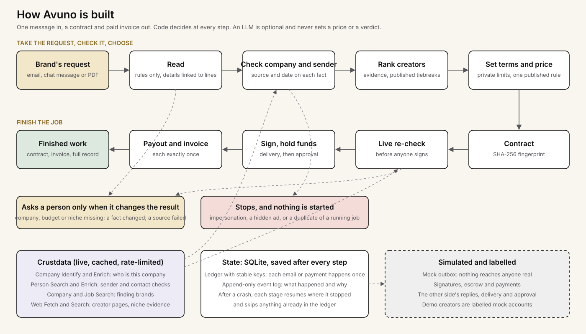
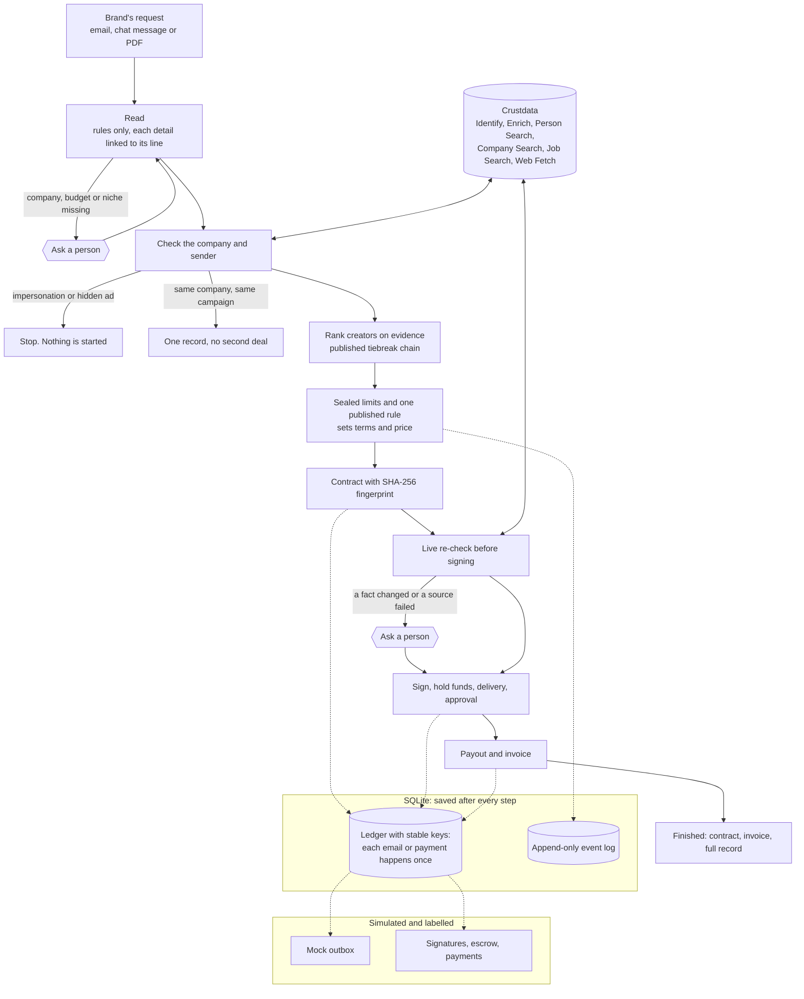

# How Avuno is built

## The same flow, in more detail

**After a crash,** each stage resumes from its last saved state. Actions already in the ledger are skipped, so nothing is sent or paid twice.

**Who decides:** code does. An LLM is optional, can only fill parsing gaps or polish a message, and never sets a price or a verdict.
